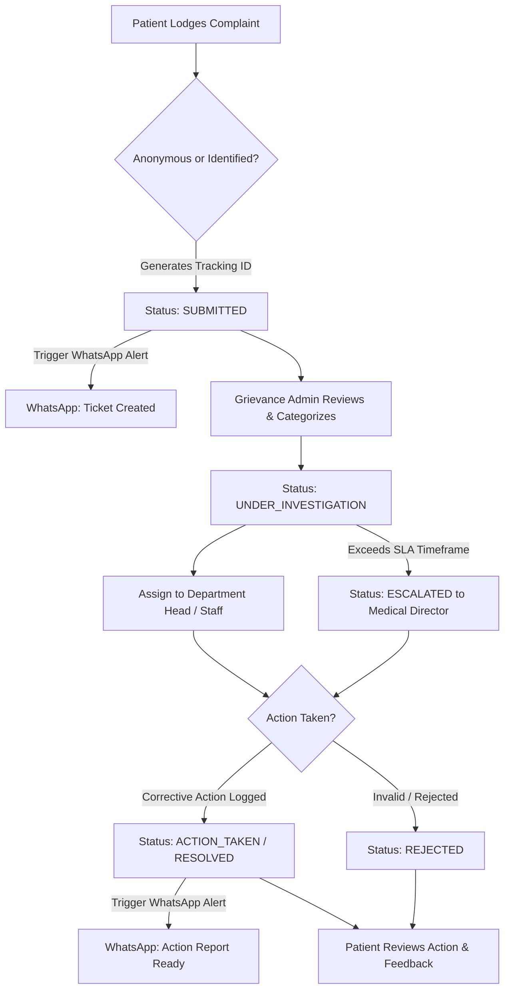

# Software Requirements Specification (SRS)
## Hospital Complaint & Grievance Management System ("Gunaso Portal")

---

## 1. Introduction

### 1.1 Purpose
This document specifies the software requirements for the **Hospital Complaint & Grievance Management System ("Gunaso Portal")**. The platform enables patients, visitors, and guardians to lodge complaints against hospital departments, units, or specific personnel, track resolution progress transparently in real-time, and receive verifiable action reports. Concurrently, it empowers hospital administrators and grievance committees to investigate complaints, assign corrective actions, manage escalations, and analyze department-wise performance.

### 1.2 Scope
The system encompasses:
- A public, mobile-friendly **Patient Complaint & Tracking Portal** (accessible via web link or hospital QR codes).
- An automated **WhatsApp & SMS Notification System** providing ticket IDs, direct tracking links, and resolution updates.
- An internal **Admin & Grievance Officer Dashboard** for reviewing, assigning, investigating, and resolving complaints.
- **Escalation & SLA Tracking Engine** for overdue grievances.
- **Analytics & Reporting Module** providing department-wise trends and resolution efficiency reports.

### 1.3 Definitions & Acronyms
- **Gunaso**: Nepali word for complaint/grievance.
- **Tracking ID / Token**: A unique 10-character alphanumeric tracking code assigned to each submitted complaint.
- **SLA**: Service Level Agreement (predefined maximum timeframe allowed to address a grievance).
- **BSP**: Business Solution Provider (e.g., Meta Cloud API, Twilio, WATI) facilitating official WhatsApp integration.

---

## 2. Platform & Tech Stack Recommendation

### Recommended Architecture: **Modern Full-Stack Web Application**

| Layer | Recommended Technology | Justification |
| :--- | :--- | :--- |
| **Frontend Framework** | **Next.js 14+ (React, TypeScript)** | Fast, SEO-optimized, mobile-responsive, supports Server Components for low-latency public tracking. |
| **Styling & UI Components** | **Tailwind CSS + Shadcn UI + Lucide Icons** | Clean, accessible, modern hospital dashboard aesthetic with dark/light mode support. |
| **Backend API** | **Next.js API Routes / Node.js Express** | Unified codebase, high throughput, lightweight API integration. |
| **Database** | **PostgreSQL** + **Prisma ORM** | Relational integrity essential for multi-department routing, audit logs, and status timelines. |
| **Authentication** | **NextAuth.js (Auth.js) / JWT** | Role-Based Access Control (RBAC) for Admins/Staff. Token-based stateless tracking for Patients without login barrier. |
| **Storage (Attachments)** | **AWS S3 / MinIO / Local Disk Storage** | Secure handling of uploaded medical bills, prescription scans, or photo evidence. |
| **Notifications** | **Meta WhatsApp Business API + Twilio / Sparrow SMS** | Multi-channel instant updates directly on WhatsApp and SMS. |

---

## 3. WhatsApp Messaging System Integration

### 3.1 WhatsApp Integration Capabilities
1. **Automated Notification Dispatch**: When a patient files a complaint via web form, an instant WhatsApp template message is dispatched with the **Tracking ID** and a 1-click tracking link (`https://gunaso.hospital.gov.np/track?id=GN-2026-0012`).
2. **Status Updates**: When an admin updates complaint status to `UNDER_INVESTIGATION`, `ACTION_TAKEN`, or `RESOLVED`, an automated WhatsApp alert is delivered to the patient.
3. **WhatsApp Interactive Chatbot (Optional Phase 2)**: Patients can send a message like `TRACK GN-2026-0012` or lodge a new complaint directly inside WhatsApp without visiting the website.

### 3.2 Pricing & Fee Structure for WhatsApp Integration

| Channel / Provider | License / Platform Fee | Per-Message / Conversation Cost | Remarks |
| :--- | :--- | :--- | :--- |
| **Meta WhatsApp Cloud API (Official)** | **$0 / month** (Direct with Meta) | **~ $0.008 to $0.012 / utility msg** (~ NPR 1.0 - 1.6 per alert) | **1,000 Free Service Conversations/month** provided by Meta. Best for direct production. |
| **Twilio for WhatsApp** | **$0 / month base** | Meta Fee + **$0.005 Twilio fee** | Easy integration via Twilio Node.js SDK. |
| **WATI / Interakt Gateway** | **~$20 to $49 / month** | Meta direct pricing | Provides a ready-made inbox & chatbot builder UI. |
| **Self-Hosted `whatsapp-web.js` (Unofficial)** | **$0 / Free** | **$0 / Free** | Connects to a standard SIM WhatsApp. Great for development/testing, but carries risk of account flag if abused. |

---

## 4. System Architecture & Workflows

### 4.1 Complaint Life Cycle State Machine



---

## 5. User Roles & Access Matrix

| Feature | Public / Patient | Grievance Admin | Department Head | Medical Director / Super Admin |
| :--- | :---: | :---: | :---: | :---: |
| File Complaint | ✅ | ❌ | ❌ | ❌ |
| Track Complaint via Token | ✅ | ✅ | ✅ | ✅ |
| WhatsApp Notification Preferences | ✅ | ❌ | ❌ | ❌ |
| Review & Assign Complaints | ❌ | ✅ | ❌ | ✅ |
| Add Investigation Notes | ❌ | ✅ | ✅ | ✅ |
| Take & Log Action | ❌ | ✅ | ✅ | ✅ |
| Reopen / Escalate Case | ❌ | ✅ | ❌ | ✅ |
| System Configuration & User Mgmt | ❌ | ❌ | ❌ | ✅ |
| Analytics & PDF Export | ❌ | ✅ | Partial | ✅ |

---

## 6. Functional Requirements

### 6.1 Patient Portal (Public Form Inputs)

#### **FR-1.1: Patient Input Schema**

1. **Privacy Mode Selection**
   - **Identified Mode** (Name & WhatsApp number recorded for direct resolution updates).
   - **Anonymous Mode** (Identity hidden from hospital staff & public; secret 4-digit PIN generated for tracking).

2. **Grievance Categorization**
   - **Category (Required Dropdown)**:
     - Medical Care & Treatment
     - Staff / Personnel Behavior & Conduct
     - Billing, Cashier & Financial Issues
     - Hygiene, Sanitation & Cleanliness
     - Infrastructure, Facilities & Amenities (A/C, Bedding, Elevator, Water)
     - Delay in Service / Queue Management
     - Pharmacy & Medicine Availability
   - **Department / Unit (Required Dropdown)**:
     - Emergency (ER), ICU, OPD, Pharmacy, Billing / Cashier, Radiology, Pathology Lab, Cardiology, General Ward, Administration, Security, Canteen.

3. **Target Personnel Details (Optional)**
   - **Target Staff Name**: Name of Doctor, Nurse, Technician, Cashier, Guard, or Officer.
   - **Designation**: (Doctor, Nurse, Receptionist, Security Guard, Billing Clerk).
   - **Staff ID / Badge No.** (if available).

4. **Incident Details**
   - **Incident Date & Time** (Picker).
   - **Location / Room / Counter**: Specific Ward Number, Bed Number, OPD Counter, or Floor.
   - **Complaint Subject / Summary**: Brief 1-line title.
   - **Detailed Description**: Full narrative of the grievance.
   - **Supporting Attachments (Optional)**: File uploads (JPEG, PNG, PDF up to 10MB) for bills, prescriptions, photos, or documents.

5. **Contact Information (Required only if Identified Mode)**
   - **Full Name**
   - **WhatsApp / Mobile Number** (for automated SMS & WhatsApp status alerts)
   - **Email Address** (Optional)
   - **Patient ID / Medical Record Number (MRN)** (Optional)

---

## 7. Non-Functional Requirements

### 7.1 Security & Data Confidentiality
- **Whistleblower & Identity Protection**: Anonymous complaints must strictly sanitize logs so staff cannot inspect submitter IP address or metadata.
- **Data Encryption**: All data transmitted via HTTPS / TLS 1.3; sensitive stored data encrypted at rest (AES-256).
- **Role-Based Access Control (RBAC)**: Strict authorization matrix preventing unauthorized staff from viewing complaints outside their domain.

### 7.2 Performance & Scalability
- **Response Time**: Page load < 1.5 seconds; API search response < 300ms.
- **Concurrent Users**: System optimized to handle 500+ simultaneous tracking requests.

### 7.3 Usability & Accessibility
- **Bilingual Interface**: Seamless toggle between **English** and **Nepali** (नेपाली).
- **Mobile-First Design**: Fully accessible on mobile browsers for patients filing complaints on hospital premises.
- **Accessibility**: UI complies with WCAG 2.1 AA guidelines (high contrast, screen-reader friendly).

---

## 8. Database Entity Relationship (ER) Schema Overview

```
Table: users
  - id (PK, UUID)
  - name
  - email
  - phone
  - role (SUPER_ADMIN, GRIEVANCE_ADMIN, DEPT_HEAD, INVESTIGATOR)
  - department_id (FK -> departments.id)

Table: departments
  - id (PK, UUID)
  - name_en
  - name_np
  - code (e.g., "ICU", "EMG", "OPD", "BIL")
  - head_user_id (FK -> users.id)
  - sla_hours

Table: complaints
  - id (PK, UUID)
  - tracking_id (UNIQUE, e.g., "GN-2026-0012")
  - is_anonymous (BOOLEAN)
  - patient_name
  - patient_phone
  - patient_email
  - category (DEPARTMENTAL, STAFF_BEHAVIOR, BILLING, HYGIENE, MEDICAL_CARE, OTHER)
  - department_id (FK -> departments.id)
  - target_person_name
  - incident_date
  - location
  - description (TEXT)
  - priority (LOW, MEDIUM, HIGH, CRITICAL)
  - status (SUBMITTED, UNDER_INVESTIGATION, ACTION_TAKEN, RESOLVED, REJECTED, ESCALATED)
  - created_at, updated_at, resolved_at

Table: complaint_actions
  - id (PK, UUID)
  - complaint_id (FK -> complaints.id)
  - actor_id (FK -> users.id)
  - action_type (NOTE, STATUS_CHANGE, ASSIGNMENT, RESOLUTION_LOG)
  - description (TEXT)
  - is_public (BOOLEAN) -- If true, patient sees this on public tracking
  - created_at

Table: attachments
  - id (PK, UUID)
  - complaint_id (FK -> complaints.id)
  - file_url
  - file_type
  - uploaded_by (PATIENT / ADMIN)

Table: feedback
  - id (PK, UUID)
  - complaint_id (FK -> complaints.id)
  - rating (1-5 Stars)
  - comments (TEXT)
  - created_at
```

---

## 9. Summary of Next Implementation Steps

1. **Database Setup**: Initialize PostgreSQL database and define Prisma Schema matching Section 8.
2. **Patient Web Form**: Build responsive Next.js form supporting file uploads and bilingual text.
3. **WhatsApp API Connection**: Configure Meta WhatsApp Cloud API credentials for automated ticket receipt and resolution dispatch.
4. **Tracking Page**: Build public `/track` endpoint allowing instant status verification.
5. **Admin Dashboard**: Build RBAC protected admin routes for ticket lifecycle management.
